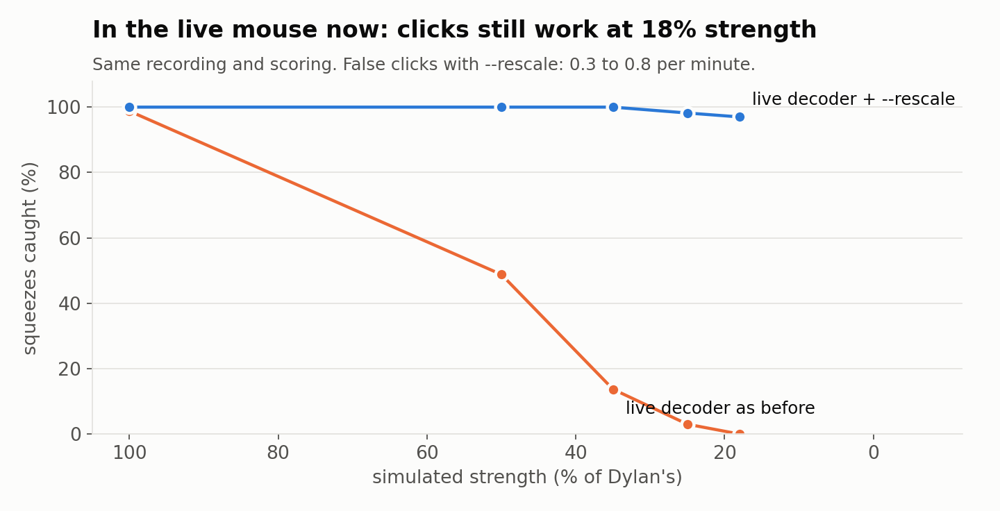

# Neuroscience Hackathon Oxford 2026: hands-free computer control from muscle signals

People with multiple sclerosis (MS) and other motor impairments often find a mouse and keyboard
tiring or impossible to use. This project turns small, comfortable movements into computer input:

- **MyoMouse:** two Myo EMG armbands replace the mouse. Forearm orientation moves the cursor,
  and a squeeze, decoded from the muscle signal, clicks. Includes one-gesture modes (point
  scanning, phone Switch Control) and a 5-gesture classifier.
- **Neuratect:** a webcam watches your hands, and poses and finger pinches become keyboard and
  mouse input. Its **Blocks** editor maps *any* input (camera, Myo bands, EEG/BCI markers over
  LSL) to any action.
- **MS stress test:** we recreated fatigue, weakness and tremor on a real EMG recording to find
  where the click decoder breaks, and added live adaptations that fix it.



## Repository

| Folder | What | Docs |
|---|---|---|
| [myomouse/](myomouse/) | EMG mouse: Bluetooth to the bands, recording with camera labels, training (LDA), live control, arena, gesture recognition | [myomouse/README.md](myomouse/README.md) |
| [devtool/](devtool/) | Live signal view, calibration, click-accuracy tests, fatigue protocol, weakness and tremor simulations | [devtool/README.md](devtool/README.md) |
| [gesture_mapper/](gesture_mapper/) | Neuratect: camera gesture control and the Blocks editor (PySide6 GUI, macOS + Windows) | [gesture_mapper/README.md](gesture_mapper/README.md) |
| [docs/](docs/) | Results ([MS stress test](docs/ms_stress_test.md)), charts, [references](docs/REFERENCES.md) | |
| [assets/](assets/) | MediaPipe hand-landmark model, shared by `myomouse` and `gesture_mapper` | |
| [tests/](tests/) | Tests for `myomouse` and `devtool` (no hardware needed) | |

## Quick start

You need macOS (Neuratect also runs on Windows) and Python 3.10 or newer; we developed on
Python 3.13 and 3.14. MyoMouse needs one or two Myo armbands. Neuratect needs a webcam.

```bash
# MyoMouse + devtool (from the repo root)
python3 -m venv .venv && source .venv/bin/activate
pip install -r requirements.txt
python -m myomouse.identify                        # which band is on which arm
python -m myomouse.record --user <you> --side right
python -m myomouse.train  --user <you> --side right
python -m myomouse.run    --user <you>

# Neuratect: its own environment (it pins different mediapipe / numpy versions)
cd gesture_mapper
python3 -m venv .venv && source .venv/bin/activate
pip install -r requirements.txt
python gui.py
```

On macOS, grant your terminal **Bluetooth**, **Accessibility** and **Camera** permission in System
Settings → Privacy & Security. Without them nothing happens, and you get no error. The full
walk-through is in [myomouse/README.md](myomouse/README.md).

## Results in brief

From one healthy user's recording, with weakness and tremor simulated
([details and limitations](docs/ms_stress_test.md)):

- **Fatigue:** squeeze strength halved over 6 minutes; the decoder still caught 168/168 squeezes.
- **Weakness:** the standard decoder fails below half strength. With `--rescale` it catches 97%
  of squeezes at 18% strength, with 0.3 false clicks a minute.
- **Tremor:** simulated 4–6 Hz tremor causes up to 77 false clicks a minute; `--hold-ms 200` brings
  that to near zero, at the cost of ~170 ms extra delay per click.

## Tests

```bash
pytest -q                          # myomouse + devtool
cd gesture_mapper && pytest -q     # Neuratect (each suite also runs as `python tests/<name>.py`)
```

## Methods and references

Clicks and gestures use the classic pattern-recognition pipeline for myoelectric control:
time-domain features (Hudgins set) on short overlapping windows, an LDA classifier,
confidence-based rejection, and debouncing. Fatigue analysis uses spectral and amplitude
features, and adaptation uses a Kalman filter on squeeze strength. Full citations and where each
one is used: [docs/REFERENCES.md](docs/REFERENCES.md).

## Team and acknowledgements

Built at the Neuroscience Hackathon Oxford 2026 (7–8 November 2026) by Dylan Simpson and
Julius Schmidt.

- Myo armband and its Bluetooth protocol: Thalmic Labs.
- Hand tracking: Google MediaPipe; the model file in [assets/](assets/) is under the Apache License 2.0.
