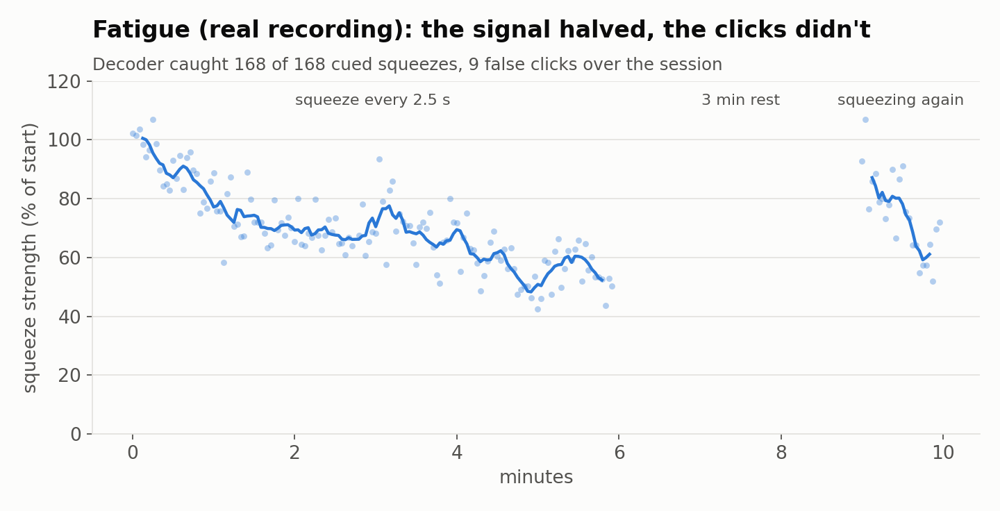
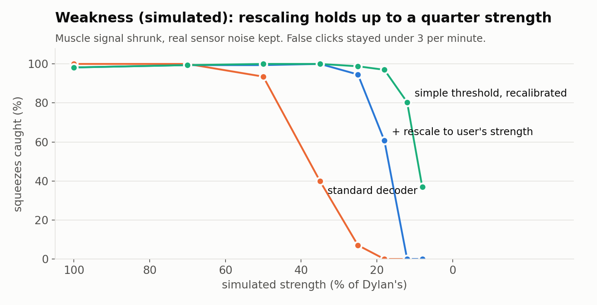
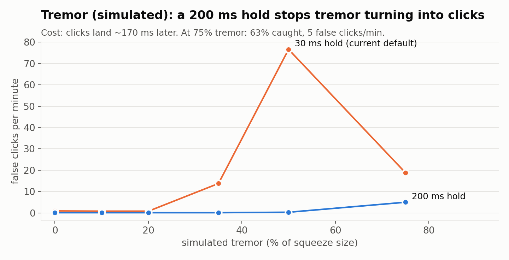
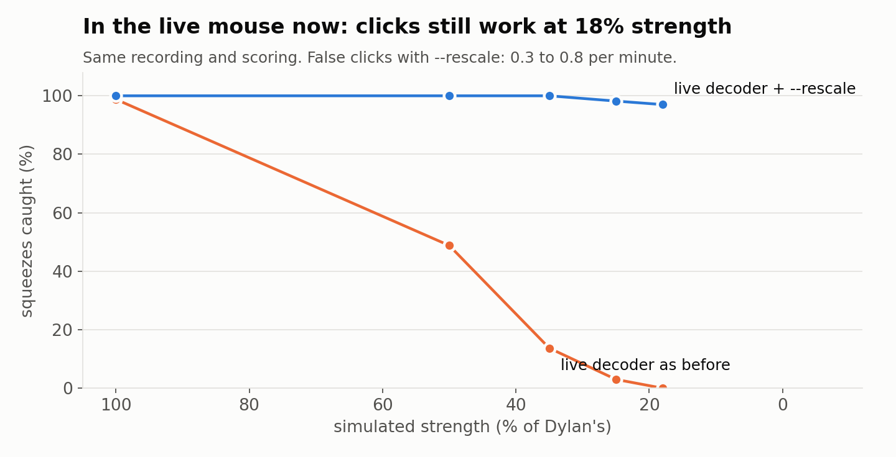

# MS stress test: does the EMG click survive fatigue, weakness and tremor?

We could not test with people with multiple sclerosis during the hackathon. Instead we took one
healthy user's real recording (Dylan, devtool mode 4 fatigue protocol) and recreated the three
things MS does to a muscle signal: **fatigue** (real), **weakness** and **tremor** (both
simulated on top of the real signal). Then we measured where the click decoder breaks.

Charts are in [charts/](charts/). Regenerate them with:

```bash
python -m devtool.slide_charts data/devtool/sessions/20261108_022630_dylan_fatigue
```

| | |
|---|---|
|  |  |
|  |  |

## Fatigue (real recording)

Squeeze strength fell to about half over 6 minutes of squeezing every 2.5 s. The decoder caught
**168 of 168** cued squeezes, with 9 false clicks.

Frequency-based fatigue markers (mean/median frequency, Dimitrov index [10], 15–45 Hz share [11])
barely moved. The Myo samples at 200 Hz, so it only sees up to 100 Hz, and most of the fatigue
shift is out of view. On this band, **signal strength is the usable fatigue marker**.

The fatigue-adaptive threshold ([devtool/fatigue.py](../devtool/fatigue.py)) did not help on this
recording: it was the worst variant, catching 149 of 168.

## Weakness (simulated: muscle signal shrunk, real sensor noise kept)

Tool: `python -m devtool.weakness_sim`. Squeeze strength is relative to the user's normal squeeze.

- The **standard decoder** works down to about half strength and fails at a third (40% caught).
- **Rescaling to the user's current strength** (Kalman-tracked squeeze strength [13]) fixes this.
  It is now available live as `--rescale`
  ([myomouse/adapt.py](../myomouse/adapt.py)). Running the live detector over the recording
  (`python -m devtool.live_eval`, [charts/live_rescale.json](charts/live_rescale.json)):

  | strength | 100% | 50% | 35% | 25% | 18% |
  |---|---|---|---|---|---|
  | standard: caught | 98.8% | 48.8% | 13.7% | 3.0% | 0% |
  | `--rescale`: caught | 100% | 100% | 100% | 98.2% | 97.0% |
  | `--rescale`: false clicks / min | 0.8 | 0.4 | 0.4 | 0.3 | 0.3 |

- A simple threshold detector recalibrated at the weaker strength holds 97% at 18%, but with
  2–3 false clicks a minute.
- Training with `--augment` (randomly weakened copies of the training data) helped only
  modestly: at half strength, caught went from 21% to 54%.

## Tremor (simulated 4–6 Hz bursts)

Tool: `python -m devtool.tremor_sim`. MS tremor is mostly postural/intention tremor at about
2.5–7 Hz [14]. The simulated bursts use the same channel pattern as the user's fist (worst case)
and are present for the whole recording, including rest.

- With the default 30 ms hold, false clicks reach **77 a minute** when the tremor is half the size
  of a squeeze.
- A **200 ms hold** (`--hold-ms 200`) keeps them near zero up to that size; each click lands
  about 170 ms later. At 75% tremor it catches 63%, and false clicks rise to 5 a minute.
- **Weakness and tremor combined** (tremor fixed while the squeeze shrinks): false clicks stayed
  at or below 0.3 a minute in every combination tested. The failure mode is missed clicks, not
  random clicks.

## Limitations

- One healthy user, one session. Weakness and tremor are simulations, not patient data.
  The next step is testing with people with MS.
- The 97% at 18% strength from the recalibrated threshold detector is **not** the live decoder.
  Don't quote it for the live system; the live figures are in the table above.
- `--hold-ms 200` and `--rescale` are tested settings, not the defaults.

[n] = [REFERENCES.md](REFERENCES.md).
